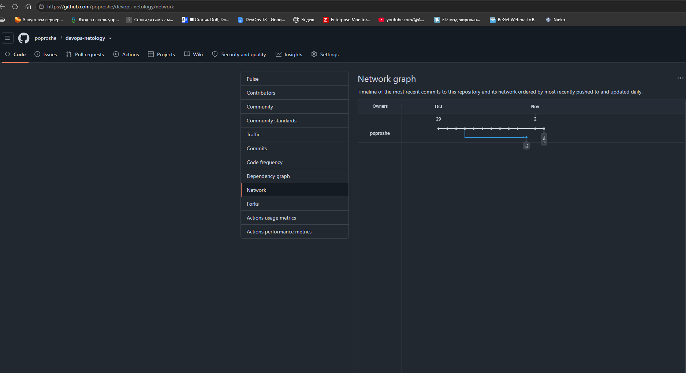

**Ссылка на репозиторий:** https://github.com/poproshe/devops-netology
**Ссылка на файл с отчетом:** https://github.com/poproshe/devops-netology/blob/main/02-git-03-branching.md

### Описание выполненной работы

В ходе выполнения задания были отработаны навыки создания веток, слияния (merge) и перебазирования (rebase) с разрешением конфликтов.

1. **Подготовка:** Создана папка `branching` со скриптами `merge.sh` и `rebase.sh`. Сделан базовый коммит.
2. **Ветка `git-merge`:** Создана от `main`. В ней двумя коммитами изменена логика работы `merge.sh` (замена `$*` на `$@`, затем использование цикла `while` и `shift`). Ветка успешно слита с `main`.
3. **Изменения в `main`:** В ветке `main` в файл `rebase.sh` добавлена строка разделителя `=====`.
4. **Ветка `git-rebase`:** Создана из прошлого (от коммита `prepare for merge and rebase`, до изменения `main`). В ней сделаны два коммита, меняющие `rebase.sh`.
5. **Rebase:** Выполнен интерактивный `rebase -i main` с последующим объединением (squash) двух коммитов в один. Ветка `git-rebase` влита в `main`.
6. Все изменения синхронизированы с GitHub и GitLab.

**Скриншот графа коммитов (Network):**

