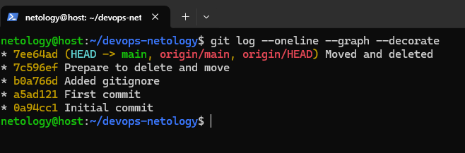
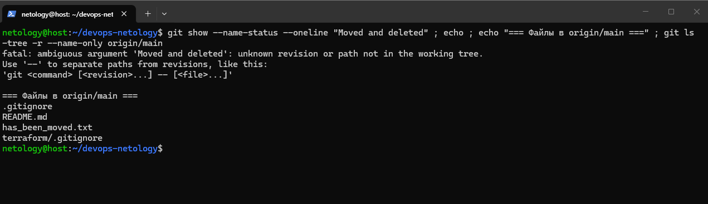
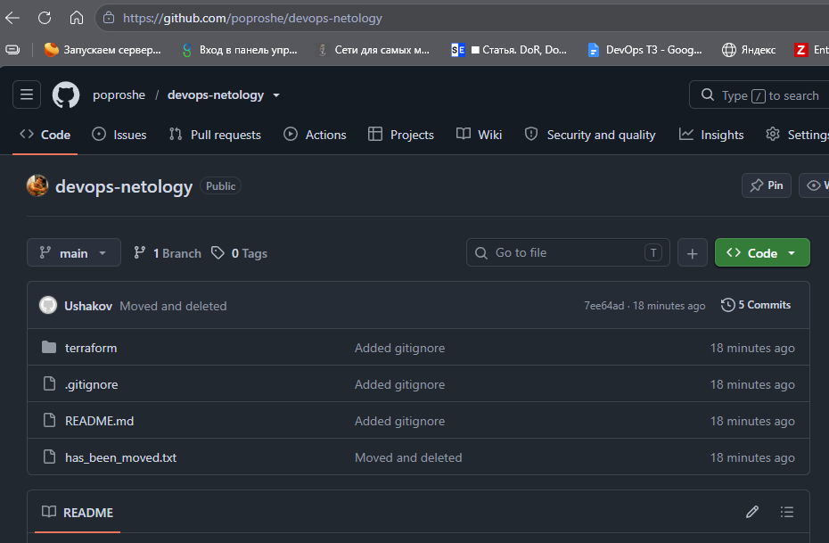

# Домашнее задание «Работа с Git»

---

## Что сделано

1. Создан публичный репозиторий `devops-netology` с `Initial commit`.
2. **`First commit`** — изменён `README.md`, проверены `git diff` / `git diff --staged`.
3. **`Added gitignore`** — пустой `.gitignore` в корне + `terraform/.gitignore` (стандартный Terraform), в `README.md` описаны игнорируемые файлы: `.terraform/`, `*.tfstate*`, `crash.log`, `*.tfvars`, `override.tf*`, `.terraformrc`, `terraform.rc`.
4. **`Prepare to delete and move`** — созданы `will_be_deleted.txt` и `will_be_moved.txt`.
5. **`Moved and deleted`** — `git rm will_be_deleted.txt` (`D`) + `git mv will_be_moved.txt has_been_moved.txt` (`R100`).
6. Все 5 коммитов запушены (`git push -u origin main`). В `origin/main` только итоговые файлы, файлов `will_be_*` нет.

---

## Скриншоты

