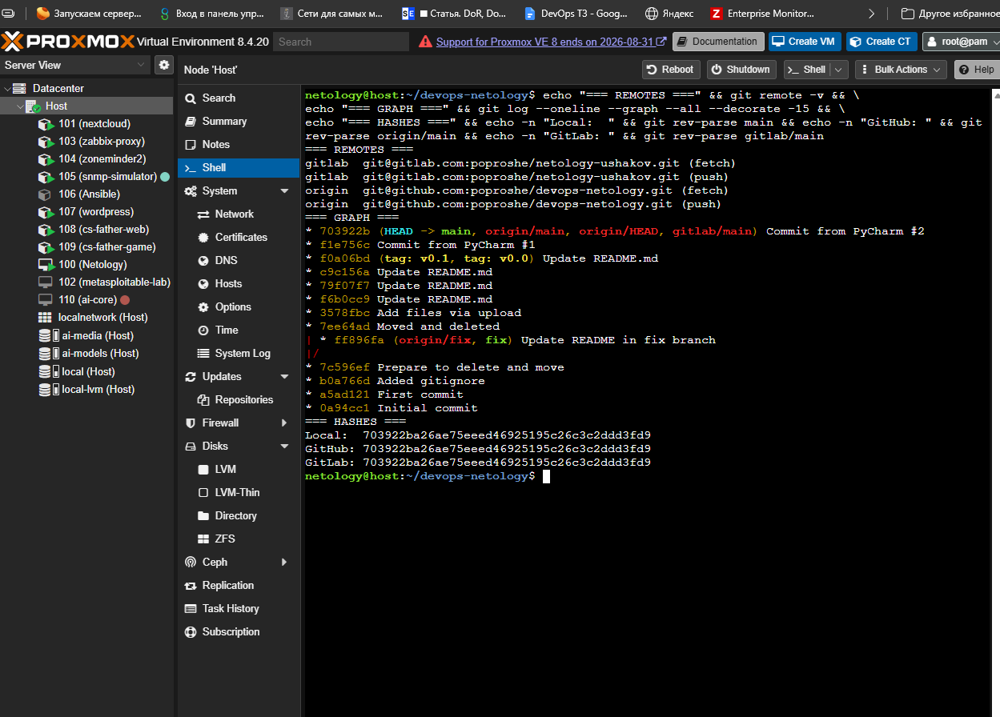
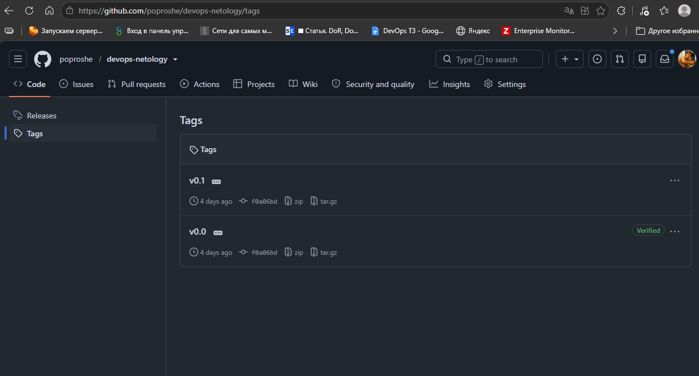
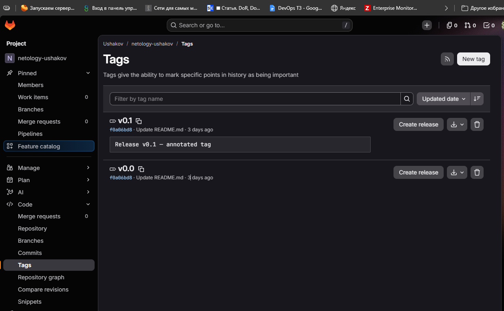
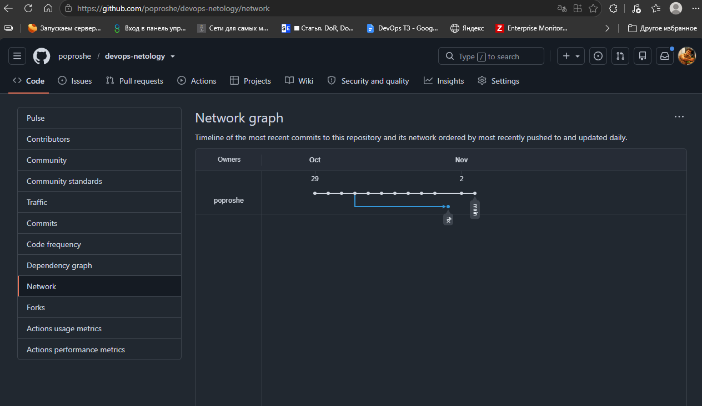
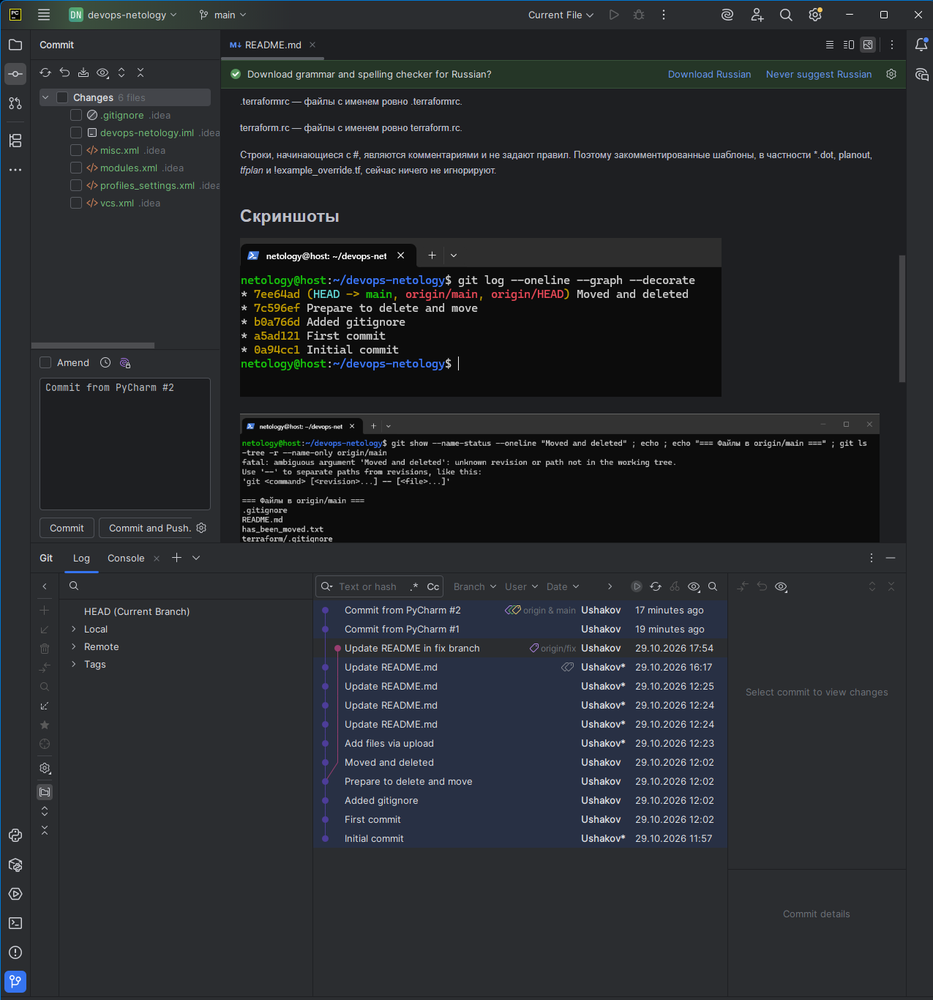

# Домашнее задание «Работа с Git» (GitLab, теги, ветки, PyCharm)

**Ссылки на репозитории:**
* GitHub: https://github.com/poproshe/devops-netology
* GitLab: https://gitlab.com/poproshe/netology-ushakov

---

### 1. Знакомимся с GitLab
Создан публичный проект на GitLab.com. В локальный репозиторий добавлен второй remote (`gitlab`). Ветка `main` и вся история коммитов успешно синхронизированы с GitHub и GitLab.

### 2. Теги
Создан легковесный тег `v0.0` и аннотированный `v0.1` (с сообщением). Оба тега отправлены во все удаленные репозитории. 
*Разница:* легковесный тег — это просто ссылка на коммит, а аннотированный хранит метаданные (автора, дату, сообщение) и отображается как полноценный релиз.

### 3. Ветки
Найден коммит `Prepare to delete and move`. От него создана ветка `fix`, в которой изменен `README.md` и сделан новый коммит. Ветка запушена в GitHub. На графе (Network) видно независимое ответвление ветки `fix` от основной истории.

### 4. Упрощаем себе жизнь (PyCharm)
В IDE PyCharm склонирован репозиторий. Через визуальный интерфейс Git сделаны два коммита (`Commit from PyCharm #1` и `Commit from PyCharm #2`). Изменения отправлены в GitHub и синхронизированы с GitLab.

---

### Скриншоты

**1. Терминал:** remote-репозитории, граф коммитов, одинаковые хеши в GitHub и GitLab.

**2. Теги на GitHub:** видно отличие аннотированного и легковесного тега.

**3. Теги на GitLab:** видно отличие Annotated и Lightweight.

**4. Схема ветвления (Network) на GitHub:** ответвление ветки fix.

**5. Коммиты в PyCharm:** история коммитов из IDE.

